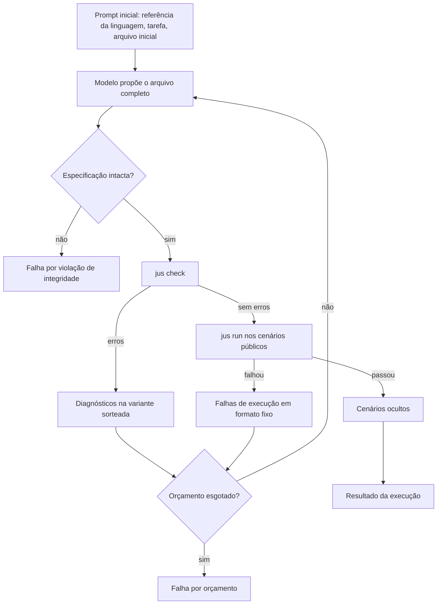

# Protocolo experimental — Estudo 1: diagnósticos do type checker e correção por agentes

| | |
|---|---|
| **Status** | Rascunho para discussão (`1.0-draft2`) |
| **Data** | 2026-11-22 |
| **Responsáveis** | Jefferson O. Andrade, Gelinton Pablo Mariano |
| **Repositório** | `jus-lang/juscore-experiments` |
| **Documentos relacionados** | *JusCore v0.1 — Definição da Linguagem*; *Arquitetura da implementação do JusCore*; README do programa |

---

## 0. Como ler este documento

Este protocolo define o primeiro estudo experimental do programa: o que se mede, como e com que análise. Ele funciona como um **pré-registro interno**.

- Antes da bateria principal, o protocolo é congelado numa tag (`protocol-v1.0`).
- Mudanças depois disso são registradas como desvios, com justificativa, e relatadas nos artigos.
- O piloto (§10) pode mudar o protocolo livremente, porque serve justamente para calibrá-lo.

Os exemplos de diagnóstico usam o TimeLockVault e o erro E301 da definição da linguagem (§10.5 e §11.1).

---

## 1. Objetivo e perguntas de pesquisa

**Objetivo:** medir se, e como, a forma dos diagnósticos do type checker afeta a capacidade de agentes de IA produzirem contratos JusCore corretos.

| # | Pergunta |
|---|---|
| **RQ1** | A variante de diagnóstico afeta a **taxa de sucesso** dos agentes? |
| **RQ2** | A variante afeta o **custo** até o sucesso (iterações e tokens)? |
| **RQ3** | Que **componentes** do diagnóstico explicam o efeito: localização, tipos esperado e encontrado, contexto do código, sugestão de correção, explicação do código de erro? |
| **RQ4** | Com o conteúdo fixo, o **formato** (texto ou JSON) importa? |
| **RQ5** (exploratória) | O efeito varia entre modelos e entre categorias de erro? |

---

## 2. Hipóteses

| # | Hipótese | Contraste |
|---|---|---|
| **H1** | Diagnósticos mais informativos aumentam a taxa de sucesso | D1 > D0; D2 > D1; D3 > D2 |
| **H2** | Diagnósticos mais informativos reduzem o número de iterações até o sucesso | Mesmos contrastes, na direção oposta |
| **H3** | Com o mesmo conteúdo, o formato não altera a taxa de sucesso | D3 ≈ D3j (teste bilateral; a ausência de diferença é o resultado esperado) |
| **H4** | O ganho de D3 sobre D2 se concentra nas categorias de erro em que existe correção mecânica | Interação variante × categoria (exploratória) |

---

## 3. Variantes de diagnóstico (variável independente)

Todas as variantes são geradas a partir do **mesmo registro interno** de diagnóstico (definição §10.1; arquitetura §5.5). Uma variante só pode omitir ou reapresentar informação; ela nunca recalcula nada.

| Variante | Conteúdo | Propósito |
|---|---|---|
| **D0 — binária** | Só o número de erros | Limite inferior: quanto vale saber apenas que falhou |
| **D1 — mínima** | Código, localização e mensagem, em uma linha | Estilo de muitos compiladores tradicionais |
| **D2 — clássica** | D1 + trecho do código com marcação, tipos esperado e encontrado, notas e localizações relacionadas | Estilo de compiladores modernos voltados a humanos (como o do Rust) |
| **D3 — orientada a agentes** | D2 + sugestões de correção com a edição exata + explicação do código de erro | A hipótese principal do trabalho |
| **D3j — orientada a agentes, em JSON** | O mesmo conteúdo de D3, em JSON | Separa o efeito do conteúdo do efeito do formato |

A explicação de cada código vem de um texto fixo por código, mantido junto do catálogo (`Code.explanation`, arquitetura §5.5). Ela não depende do programa analisado.

### 3.1 Exemplo: o mesmo erro nas cinco variantes

Erro: na linha 26 do TimeLockVault, `requires ctx.amount == 5`.

**D0**

```text
check failed: 1 error
```

**D1**

```text
vault.jus:26:26: error[E301]: type mismatch: expected 'Tez', found 'Nat'
```

**D2**

```text
error[E301]: type mismatch: expected 'Tez', found 'Nat'
  --> vault.jus:26:26
   |
26 |   requires ctx.amount == 5
   |                          ^ expected 'Tez', found 'Nat'
   |
note: the left operand 'ctx.amount' has type 'Tez'
```

**D3**

```text
error[E301]: type mismatch: expected 'Tez', found 'Nat'
  --> vault.jus:26:26
   |
26 |   requires ctx.amount == 5
   |                          ^ expected 'Tez', found 'Nat'
   |
note: the left operand 'ctx.amount' has type 'Tez'
help: write the amount in mutez: replace '5' with '5mutez' at 26:26-26:27
help: write the amount in tez: replace '5' with '5tz' at 26:26-26:27
explanation[E301]: an expression has a type different from the one its context
  requires. JusCore has no implicit conversions: numeric literals without a
  suffix are 'Nat'; amounts of tez need the suffix 'tz' or 'mutez'.
```

**D3j**: o objeto JSON da definição §10.5, acrescido do campo `"explanation"` com o mesmo texto de D3.

### 3.2 O que é constante entre as variantes

- **Falhas de execução nos cenários** (códigos R e expectativas não atendidas) são mostradas sempre no mesmo formato, em todas as variantes. Assim, só os diagnósticos de compilação variam.
- **Avisos** seguem a variante, como os erros.
- A **ordem** dos diagnósticos é a mesma em todas as variantes.

---

## 4. Tarefas

### 4.1 Tipos de tarefa

| Tipo | O agente recebe | O agente deve | Por que existe |
|---|---|---|---|
| **R — reparo** | Um contrato com 1 a 3 erros de compilação injetados e a especificação aprovada | Fazer o contrato compilar e passar nos cenários, sem mexer na especificação | Toda execução passa por diagnósticos: é o teste mais direto das hipóteses |
| **G — geração** | O enunciado, as declarações de tipos e storage, as assinaturas dos entries e as cláusulas `requires`/`ensures` aprovadas | Escrever os corpos dos entries e os defs auxiliares | Situação mais realista; os diagnósticos aparecem conforme os erros do próprio agente |

### 4.2 Conjunto de tarefas

São 24 tarefas: 16 de reparo e 8 de geração.

**Reparo (R01–R16).** Os contratos de referência (TimeLockVault, Escrow e Multisig) e as tarefas de geração depois de resolvidas recebem erros injetados por mutação, distribuídos pelas categorias do catálogo:

| Categoria | Exemplos de mutação | Tarefas |
|---|---|---|
| Nomes (E2xx) | Nome de campo trocado; uso de `ctx` num def; sombreamento | 3 |
| Tipos (E3xx) | `Nat` no lugar de `Tez`; campo faltando num literal; operador incompatível; lista vazia sem anotação | 5 |
| Padrões (E4xx) | Braço ausente num `match`; construtor de outro tipo | 3 |
| Contrato e especificação (E5xx, E6xx) | `Operation` no storage; `Ops.*` fora de especificação | 2 |
| Combinadas | Dois ou três erros de categorias diferentes | 3 |

**Geração (G01–G08)**, em ordem crescente de dificuldade:

| Tarefa | Contrato | O que exercita |
|---|---|---|
| G01 | Cofrinho: só o dono saca, e só depois de uma meta de saldo | Autorização, comparação de `Tez` |
| G02 | Cofre com prazo e dono substituível | Autorização, tempo, atualização de storage |
| G03 | Escrow com árbitro | Três partes, estados, reembolso |
| G04 | Vaquinha com meta e prazo, com reembolso se a meta falhar | `Map[Address, Tez]`, tempo, vários estados |
| G05 | Leilão simples com lance mínimo e devolução do lance anterior | Transferência ao perdedor, estados |
| G06 | Multisig com troca de destinatário aprovada pelo limiar | `List`, `Map`, autorização por limiar |
| G07 | Liberação de fundos em duas parcelas datadas | Tempo, aritmética, estados |
| G08 | Registro de nomes com taxa e transferência de titularidade | `Map[String, Address]`, taxa, autorização |

Cada tarefa é um diretório:

```text
tasks/G03-escrow-arbiter/
├── task.md              enunciado em linguagem natural
├── start.jus            arquivo inicial (especificação aprovada e corpos vazios ou com erros)
├── spec.lock            forma normalizada das cláusulas aprovadas, para detectar alterações
├── public/*.scenario    1 ou 2 cenários visíveis ao agente
├── hidden/*.scenario    cenários de aceitação, invisíveis ao agente
├── solution.jus         solução de referência, revisada por humano
└── meta.yaml            tipo, categoria, dificuldade, erros injetados (nas tarefas R)
```

Para cada tarefa:

- os cenários ocultos cobrem o caminho feliz, cada `requires` de autorização, estado errado e valor errado (arquitetura §9.3);
- a solução de referência **DEVE** passar em todos os cenários;
- toda a suíte é revisada por humano antes do congelamento.

**Sem contaminação.** O JusCore não existe nos dados de treino de nenhum modelo, e as tarefas são inéditas. É uma vantagem metodológica em relação a estudos com linguagens conhecidas e deve ser explorada nos artigos.

---

## 5. Agentes e ambiente de execução

### 5.1 Dois modos de execução

| Modo | Como funciona | Uso |
|---|---|---|
| **Laço controlado** (principal) | Um *harness* próprio conversa com o modelo pela API, num laço fixo: o modelo propõe o arquivo, o harness roda `jus check` e devolve os diagnósticos na variante sorteada, e assim por diante, até o sucesso ou o fim do orçamento | Bateria principal. Dá controle exato do contexto, das iterações e do custo |
| **Agente de linha de comando** (secundário) | Uma ferramenta de agente pronta trabalha no diretório da tarefa e chama `jus` pelo shell. Um *wrapper* fixa a variante de diagnóstico e impede que o agente escolha outra | Verificação de validade externa num subconjunto de tarefas |

A ferramenta de agente usada para **gerar a implementação do JusCore** (questão A4 da arquitetura) é uma decisão separada desta. No experimento, o modo principal é o laço controlado, independentemente da ferramenta escolhida para a geração.

### 5.2 Laço controlado



Regras:

- **Contexto inicial**, igual em todas as variantes:
  - a referência da linguagem para agentes, que **não** inclui o catálogo de diagnósticos nem as explicações dos códigos;
  - o enunciado da tarefa;
  - o arquivo inicial;
  - os cenários públicos.
- **A cada iteração**, o modelo devolve o arquivo completo, num bloco de código delimitado. Uma resposta sem bloco válido conta como iteração perdida.
- **Orçamento:** no máximo 8 chamadas a `jus check` por execução e um limite de tokens por execução, a fixar no piloto.
- **Ao fim da execução**, a última versão que compila e passa nos cenários públicos é avaliada nos cenários ocultos. O sucesso exige passar em todos.
- **Cada execução começa com contexto limpo:** nada passa de uma execução para outra.

### 5.3 Modelos

- Pelo menos um modelo comercial de ponta e pelo menos um modelo de pesos abertos.
- Para cada modelo, registram-se:
  - o identificador exato da versão;
  - os parâmetros de amostragem (usar os padrões do fornecedor e registrá-los);
  - a data das execuções.
- Todas as execuções de um modelo usam a mesma versão. Se o fornecedor retirar a versão no meio da bateria, isso é um desvio a relatar.

### 5.4 Isolamento

- O diretório de trabalho do agente contém só os arquivos da tarefa: nunca os cenários ocultos, a solução ou o código-fonte do `jus`.
- No modo de linha de comando, o `jus` disponível é um wrapper que fixa `--diagnostics` na variante sorteada e rejeita outras opções de diagnóstico.

---

## 6. Desenho experimental

- **Fatores:**
  - variante de diagnóstico (5 níveis), dentro de tarefa: cada tarefa é executada em todas as variantes;
  - modelo (pelo menos 2 níveis).
- **Repetições:** *k* execuções independentes por combinação de tarefa, variante e modelo, para capturar a variabilidade do modelo.
- **Ordem:** as execuções são sorteadas, com semente registrada, para que horário e carga do fornecedor não se confundam com a variante.
- **Tamanho:** com 24 tarefas e *k* = 7, são 168 execuções por variante e por modelo. Um cálculo de poder para duas proporções (50% contra 65%, α = 0,05, poder de 0,8) pede cerca de 170 execuções por grupo, ignorando a correlação dentro das tarefas. Como as mesmas tarefas aparecem em todas as variantes, o desenho pareado tende a ter mais poder. O piloto estima a variabilidade, e o *k* final é fixado no congelamento.
- **Total da bateria principal:** 24 tarefas × 5 variantes × 2 modelos × 7 repetições = 1 680 execuções. O custo estimado sai do piloto.

---

## 7. Métricas

| Métrica | Definição | Tipo |
|---|---|---|
| **Sucesso** (primária) | Compila sem erros, passa em todos os cenários ocultos e mantém a especificação intacta, dentro do orçamento | Binária |
| Compilação | Chegou a uma versão sem erros de compilação | Binária |
| Iterações até compilar | Número de chamadas a `jus check` até a primeira versão sem erros | Contagem, censurada no orçamento |
| Iterações até o sucesso | Número de chamadas até a versão final bem-sucedida | Contagem, censurada |
| Custo | Tokens de entrada e de saída; custo em dinheiro, se houver | Contínua |
| Resolução na primeira iteração | Fração dos erros injetados (tarefas R) corrigidos na primeira resposta depois do diagnóstico | Proporção |
| Regressões | Erros novos introduzidos por uma correção | Contagem |
| Violação de integridade | Alteração das cláusulas aprovadas, detectada pela comparação com `spec.lock`. Conta como falha | Binária |
| Trivialização | Ocorrência de W602 ou W603 numa versão proposta | Binária |
| Sucesso só nos cenários públicos | Passou nos públicos e falhou nos ocultos (sobreajuste aos exemplos) | Binária |

---

## 8. Análise

### 8.1 Análise principal (RQ1, H1, H3)

- **Modelo:** regressão logística de efeitos mistos: sucesso ~ variante + modelo + (1 | tarefa).
- **Resultados relatados:** razões de chances e intervalos de confiança de 95%.
- **Contrastes planejados:**
  - D1 contra D0;
  - D2 contra D1;
  - D3 contra D2;
  - D3j contra D3 (bilateral; ver H3).
- **Correção para comparações múltiplas:** Holm, sobre os quatro contrastes.
- **Visualização:** taxas de sucesso por variante e por modelo, com intervalos de confiança.

### 8.2 Custo (RQ2, H2)

- Curvas de Kaplan–Meier de "iterações até o sucesso", com censura no orçamento, por variante.
- Modelo de riscos proporcionais de tempo discreto, com tarefa como efeito aleatório.
- Tokens e custo comparados por variante, com modelo linear de efeitos mistos sobre o logaritmo do custo.

### 8.3 Componentes e categorias (RQ3, RQ5, H4)

- A escada D0 → D1 → D2 → D3 já isola, um por um, os componentes acrescentados em cada degrau.
- Interação variante × categoria de erro, nas tarefas de reparo.
- Interação variante × modelo.

### 8.4 Análise qualitativa

Uma amostra estratificada de transcrições, incluindo falhas de todas as variantes, é codificada por dois avaliadores com um esquema de modos de falha definido no piloto. Categorias iniciais:

- ignorou o diagnóstico;
- interpretou mal a localização;
- usou sintaxe de outra linguagem (Lean, OCaml, Solidity);
- alterou ou trivializou a especificação;
- corrigiu o sintoma e introduziu outro erro;
- ficou em ciclo (repetiu a mesma correção).

A concordância entre avaliadores é medida por kappa de Cohen.

---

## 9. Ameaças à validade

| Tipo | Ameaça | Mitigação |
|---|---|---|
| Interna | Sensibilidade ao texto do prompt | Prompt único e fixo para todas as variantes, congelado com o protocolo |
| Interna | Variação do modelo ao longo do tempo | Versões fixas, ordem sorteada, datas registradas |
| Interna | Vazamento da variante (o agente pedir outro formato) | Laço controlado; wrapper no modo de linha de comando |
| Construto | Os cenários não capturam toda a correção | Vários cenários ocultos por tarefa, incluindo os de segurança; revisão humana das soluções |
| Construto | "Sucesso" depende do orçamento escolhido | Relatar também as curvas de iterações até o sucesso |
| Externa | Linguagem pequena, tarefas pequenas, poucos modelos | Declarar o escopo; o modo de linha de comando serve de verificação parcial |
| Externa | A sintaxe do JusCore lembra Lean e OCaml, e os modelos têm preferências prévias | Medir os erros de "sintaxe de outra linguagem" na análise qualitativa |
| Conclusão | Poder estatístico | Cálculo de poder com os dados do piloto; desenho pareado |
| Conclusão | Comparações múltiplas | Contrastes planejados e correção de Holm |

---

## 10. Piloto

**Objetivos:**

- testar o harness e o fluxo de dados;
- estimar a taxa de sucesso, a variabilidade e o custo;
- calibrar o orçamento;
- definir o esquema de codificação qualitativa.

**Piloto mínimo, para a WorldCIST'27 (opcional):**

| Elemento | Escopo |
|---|---|
| Implementação necessária | M0 a M3 restritos aos códigos E201, E204, E301, E302, E306 e E401, mais renderizadores para D1 e D3 |
| Tarefas | 6 tarefas de reparo derivadas do TimeLockVault e do Escrow |
| Variantes | D1 e D3 |
| Modelos | 1 |
| Repetições | 3 |
| Execuções | 36 |
| Avaliação | Só compilação: sucesso é chegar a uma versão sem erros com a especificação intacta. Sem o interpretador, não há cenários |

**Ponto de decisão: 2026-11-29.** Se o type checker mínimo não estiver funcionando nessa data, o artigo sai como desenho experimental sem piloto. Os resultados do piloto, se houver, são apresentados como preliminares e não testam as hipóteses.

**Piloto completo (dezembro de 2026):**

- todas as variantes;
- 8 tarefas;
- 2 modelos;
- *k* = 3;
- com interpretador e cenários ocultos.

Depois dele, ajusta-se o protocolo e congela-se a versão `protocol-v1.0`.

---

## 11. Reprodutibilidade e ética

- **Repositório `juscore-experiments`:** protocolo, tarefas, harness, prompts, sementes, registros brutos de cada execução e scripts de análise.
- **Registros grandes:** se pesarem demais para o git, ficam num armazenamento externo com somas de verificação no repositório.
- **Versão do `jus`:** fixada pelo commit do `juscore` usado na bateria e registrada em cada execução.
- **Ambiente:** o `juscore-experiments` tem um `flake.nix` próprio, que inclui o `juscore` como entrada fixada.
- **Ética:** não há participantes humanos. Os humanos envolvidos são os pesquisadores, que operam o experimento e codificam as transcrições. Por isso não se aplica comitê de ética.
- **Revisão cega da WorldCIST:**
  - a versão submetida não pode ter links para `jus-lang` nem citações não anonimizadas aos artigos de 2025 (WorldCIST 2025 e CHILECON 2025);
  - os artefatos, se forem citados, precisam estar num repositório anonimizado. Como os repositórios estão no GitHub, dá para gerar uma cópia anônima de `juscore-experiments` com o Anonymous GitHub (`anonymous.4open.science`).

---

## 12. Estrutura do repositório `juscore-experiments`

```text
juscore-experiments/
├── README.md
├── protocol.md               este documento
├── flake.nix                 ambiente; inclui o juscore como entrada fixada
├── tasks/                    R01–R16, G01–G08 (§4)
├── reference/                referência da linguagem para agentes, congelada
├── prompts/                  prompt do laço controlado, congelado
├── harness/                  laço controlado e wrapper do modo de linha de comando
├── runs/                     registros brutos (uma pasta por execução)
├── analysis/                 scripts de análise
└── deviations.md             desvios do protocolo após o congelamento
```

---

## 13. Questões abertas

| # | Questão | Proposta inicial |
|---|---|---|
| P1 | Linguagem do harness e da análise | Python, pela disponibilidade dos SDKs dos fornecedores e das bibliotecas estatísticas |
| P2 | Quais modelos usar | Decidir no piloto, conforme o acesso e a verba |
| P3 | Valor de *k* e orçamento de tokens | Fixar após o piloto |
| P4 | Incluir uma linha de base em outra linguagem (por exemplo, CameLIGO) | Fora do Estudo 1, que compara variantes de diagnóstico dentro do JusCore |
| P5 | Quem escreve a referência da linguagem para agentes | Derivá-la da definição, com revisão humana, antes do piloto completo |

---

## Histórico

- `1.0-draft1` (2026-11-22): primeira versão para discussão.
- `1.0-draft2` (2026-11-22): anonimização estendida ao artigo da CHILECON 2025; cópia anônima dos artefatos pelo Anonymous GitHub (§11).
